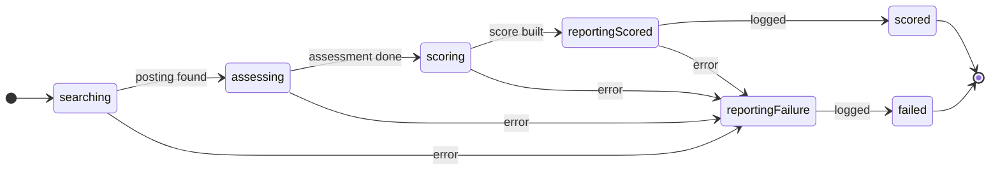

# ai-job-classifier

Scores a list of jobs against your resume and preferences, and saves a ranked shortlist. For each job it searches the web for the posting (Tavily), asks a model (OpenRouter, through the Vercel AI SDK) to assess the fit, and calculates the score in code.

## Setup

```bash
pnpm install
```

Set these in your shell or a `.env` file. `env.ts` validates them at startup.

| Variable | Required | Purpose |
| --- | --- | --- |
| `OPENROUTER_API_KEY` | yes | OpenRouter API key |
| `TAVILY_API_KEY` | yes | Web search for job descriptions |
| `AGENT_MODEL` | no | OpenRouter model ID (default `anthropic/claude-haiku-5.5`) |

## Your profile

Create `profile/resume.md` (any plain description of your background) and `profile/preferences.md`. Both are gitignored, and the app won't start without them.

Each bullet under `## Hard requirements` in `preferences.md` is checked separately for every job, so write one requirement per bullet, dealbreakers included. A job that breaks one is capped at a score of 30.

```md
# Preferences

## Hard requirements

- Work rights: skip jobs that require permanent residency or citizenship.
- Dealbreaker: no on-call rotation.

## Wanted

- Target roles: ...
- Preferred stack: ...
```

## Jobs

Put the jobs in `data/job-alerts.json`, an array of `{ title, company, location, salary, source, url }`. Only `title` and `company` are required.

## Run

```bash
pnpm start                      # data/job-alerts.json
pnpm start my-jobs.json         # data/my-jobs.json
pnpm start --concurrency 5      # jobs scored at once (-c, default 3)
```

Scores are saved to `output/<timestamp>.json`, best first. Each entry has `title`, `company`, `score`, `confidence`, `reasons` and `source_url`. `pnpm typecheck` type-checks the project.

## How a job is processed

Each job runs through the state machine in `src/state-machine.ts`. A step that fails sends the job to `reportingFailure`, which logs the error. The job then gets a score of 0 and is marked failed, and the run carries on with the other jobs.



## How scoring works

The settings are fixed in `src/scoring-config.ts`. The model marks each hard requirement `pass`, `fail` or `unknown` and gives each dimension a level. The code adds up the points.

| Dimension | Points | Judges |
| --- | --- | --- |
| Stack | 40 | The technologies the posting requires, against your resume |
| Domain | 60 | How well the job matches your resume and what you're looking for |

Partial matches are acceptable. Seniority and salary aren't scored.

The score is the points earned divided by the points available, scaled to 100. A failed hard requirement caps it at 30. Confidence is `low` when no posting was found, `medium` when only part was found or any hard requirement is unknown, and `high` otherwise.

## Logs

The console prints one line per job (score, confidence, time, tokens) and a final summary. The same run is written to `logs/<date>.jsonl`, one JSON object per line, each with a `runId` shared by the run.

| Event | When | Notable fields |
| --- | --- | --- |
| `run_start` | The run begins | jobs file, job count, concurrency, model |
| `job_scored` | A job was scored | score, confidence, `searchMs`, `assessMs`, token usage, search results, assessment |
| `job_failed` | A job could not be scored | `stage` (`search`, `assess` or `score`) and the error |
| `run_end` | The run finishes | scored and failed counts, token totals, duration, output file |
| `run_failed` | The run stops early | the error |

The logs contain your resume details and job postings, so don't share them.
